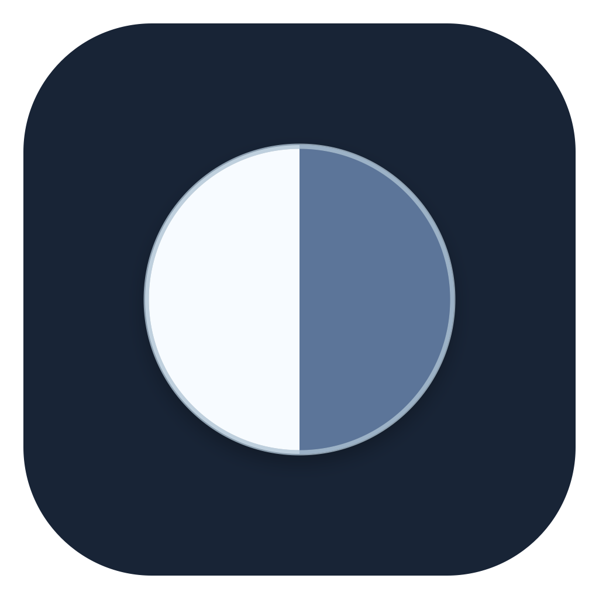
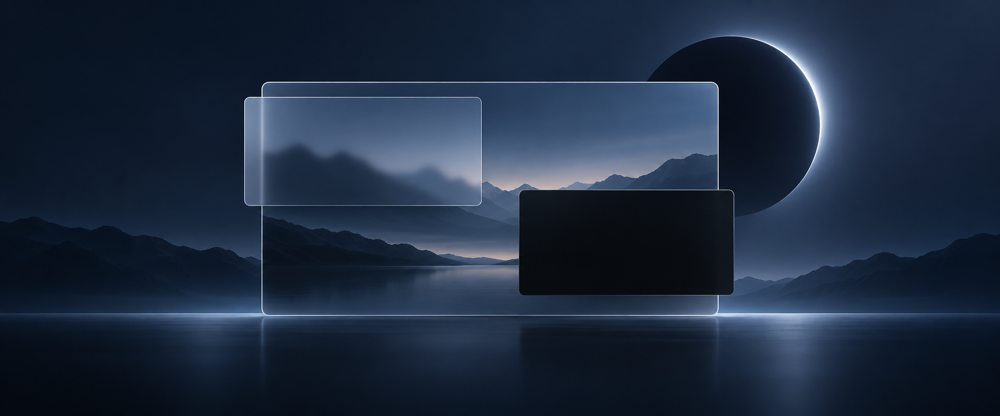
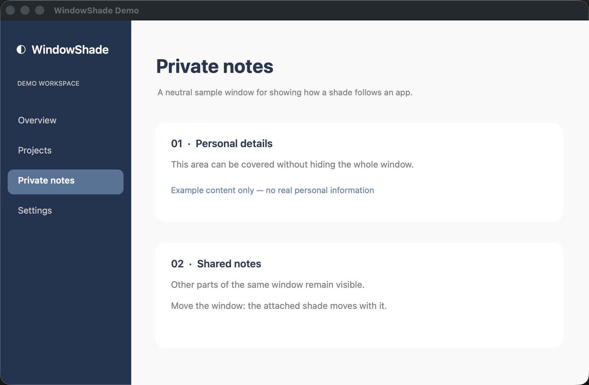
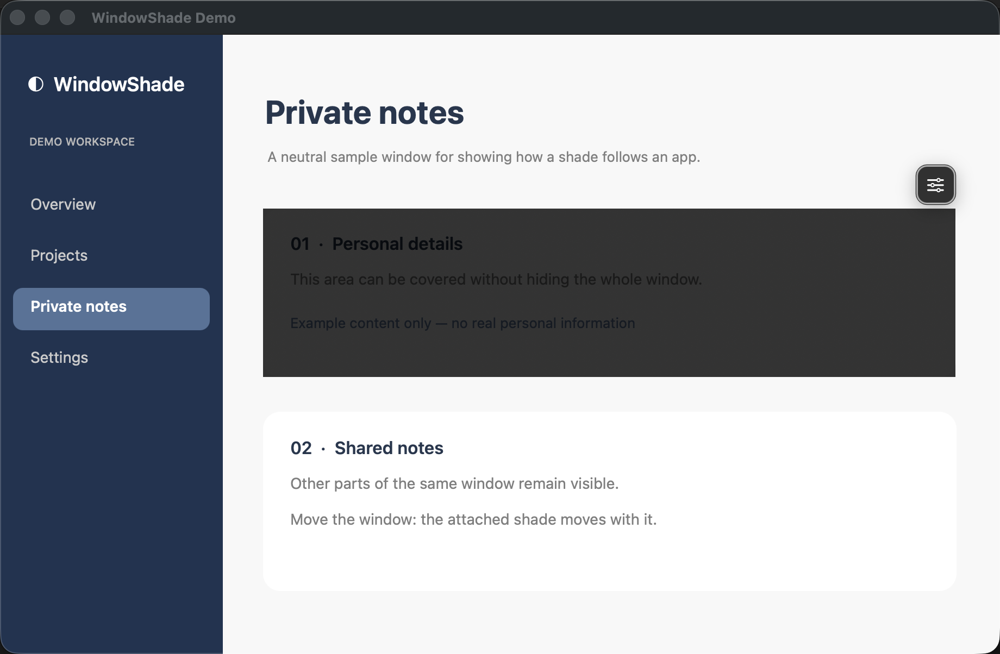
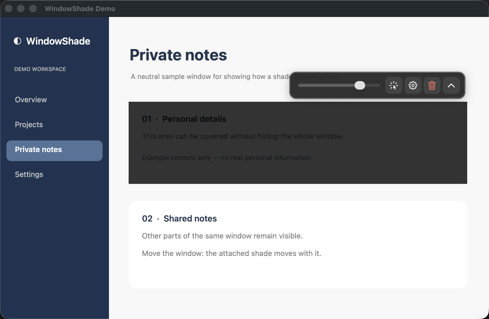
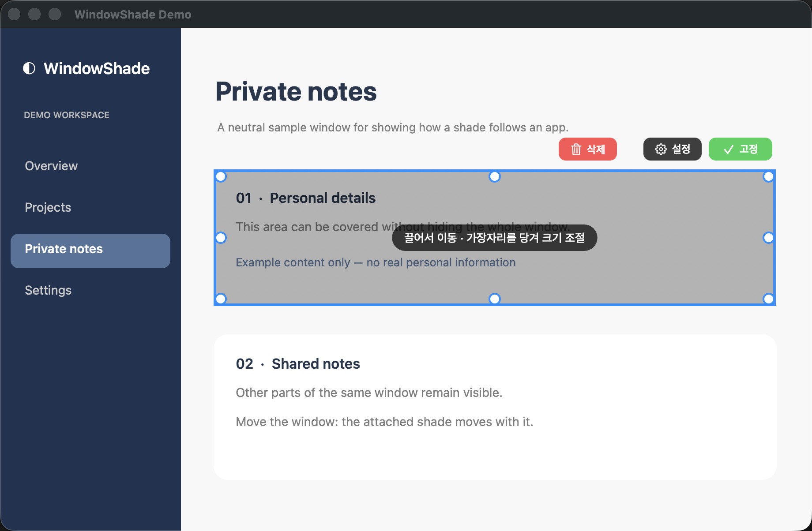

<p align="center"></p>

<h1 align="center">WindowShade · 창 가리개</h1>

<p align="center">창 전체를 숨기지 않고, 필요한 부분만 가볍게 가리세요.</p>
<p align="center">macOS 14+ · Apple Silicon · Swift / AppKit</p>



> 위 이미지는 기능을 표현한 컨셉 이미지입니다. 실제 앱 화면은 아닙니다.

아이폰 미러링 화면이 너무 밝거나, 브라우저의 일부를 잠시 가리고 싶을 때 쓰는 메뉴 막대 앱입니다. 가리개는 창을 따라 움직이며 여러 영역을 각각 조절할 수 있습니다.

## 실제 사용 모습

아래 화면은 **실제 WindowShade 1.3.6**를 정보가 없는 예시 창에 적용해 촬영했습니다. 첫 번째 카드만 어두워지고 나머지는 그대로 보입니다.

| 가리기 전 | 첫 번째 영역만 가린 뒤 |
| :---: | :---: |
|  |  |

가리개 위의 조절 아이콘을 **클릭**하면 어둡기 슬라이더와 스포트라이트·설정·삭제·접기 버튼이 나타납니다.



## 할 수 있는 일

| 기능 | 사용 방식 |
| --- | --- |
| 창에 붙는 가리개 | 아이폰 미러링에는 자동으로 붙고, 다른 앱 창에는 직접 추가할 수 있습니다. |
| 여러 영역 | 같은 창에 가리개를 여러 개 붙이고 위치와 크기를 각각 정합니다. |
| 가리개별 조절 | 어둡기·색·마우스 주변 밝게·클릭 통과·테두리를 따로 설정합니다. 어둡기를 최대로 올리면 완전히 가려집니다. |
| 카메라 반응 | 선택한 가리개만 반응합니다. 다른 얼굴이 화면을 향하거나, 얼굴이 보이지 않는 가까운 상반신이 정면으로 보이면 즉시 검게 가립니다. |

화면 위에 반투명 막을 그리는 방식이라 **화면 기록 권한은 필요하지 않습니다.** 카메라 반응 기능을 사용할 때만 카메라 권한을 요청합니다.

## 설치

1. [v1.3.6 릴리스](https://github.com/Harry1757/windowshade/releases/tag/v1.3.6)에서 `WindowShade.zip`을 내려받아 압축을 풉니다.
2. `창 가리개.app`을 **응용 프로그램** 폴더로 옮겨 실행합니다. 앱 창 대신 화면 상단 메뉴 막대에 `◐`가 나타납니다.
3. 이 앱은 회사 개발 인증서를 사용하지 않았습니다. macOS가 첫 실행을 막으면 [Apple 안내](https://support.apple.com/en-us/102445)에 따라 **시스템 설정 → 개인정보 보호 및 보안 → 그래도 열기**에서 직접 확인합니다.

아이폰 미러링 창을 열면 기본 가리개가 붙습니다. 작은 조절 아이콘을 **클릭**해 어둡기를 조절하세요. `⌘⇧D`로 모든 가리개를 잠시 숨기거나 다시 표시할 수 있습니다.

## 원하는 곳만 가리기

메뉴 막대의 `◐`를 클릭하면 바로 고를 수 있습니다.

- **현재 창 전체 가리기**: 맨 앞 창 전체에 가리개를 붙입니다.
- **현재 창 일부만 가리기…**: 가리개를 붙이고 곧바로 영역 편집으로 들어갑니다.
- **창 선택해서 붙이기**: 목록에서 창을 고릅니다. 창을 움직이거나 크기를 바꾸면 가리개가 따라갑니다.
- **떠 있는 가리개 추가**: 창과 무관하게 화면 위의 한 곳을 가립니다.

영역 편집 중에는 가리개를 **끌어서 옮기고, 가장자리·모서리를 당겨 크기를 바꿉니다.** 영역 바로 위에 뜨는 **삭제 · 설정 · 고정** 버튼으로 끝내며, `Return`을 눌러도 고정됩니다. 편집하는 동안 가리개는 반투명해져 뒤의 내용을 보며 맞출 수 있습니다.



- 한 창의 여러 곳을 가리려면 가리개 메뉴의 **같은 창에 새 영역 추가**를 반복합니다.
- 모서리 모양은 설정의 **모서리 둥글기**에서 바꿉니다. 기본값 0은 선택선과 가리개 모두 각진 모서리입니다.
- 아이폰 미러링은 **아이폰 화면만 가리기 / 조작부까지 가리기**를 선택할 수 있습니다.

## 카메라 반응 · 실험적 기능

1. `◐ → 카메라 트래킹 → 나로 지정…`에서 혼자 카메라를 정면으로 보고 본인을 등록합니다.
2. **트래킹 켜기**를 선택한 다음, 반응시킬 가리개에서만 **카메라 반응**을 켭니다.
3. 다른 얼굴이 화면을 향하면 해당 가리개가 즉시 검게 됩니다. 얼굴이 안 보여도 가까운 상반신이 정면으로 감지되면 반응합니다. 감지 대상이 사라진 뒤 약 2.5초가 지나면 원래 설정으로 돌아갑니다.

v1.3.6에서 보강한 점입니다.

- **다가옴·돌아봄 감지**: 다른 사람 얼굴이 1초 안에 눈에 띄게 커지거나 정면 쪽으로 돌아오면, 아직 화면을 보기 전이라도 먼저 가립니다.
- **더 넓은 시야각**: 다른 사람은 고개가 더 비스듬해도(약 55도) 화면을 보는 것으로 칩니다. 본인은 기존 기준을 유지합니다.
- **본인 오인식 완화**: 본인 얼굴이 1.5초 이내에 같은 자리·크기로 이어지면, 순간적으로 특징이 흔들려도 본인으로 봅니다.
- **더 빠른 반응**: 분석 간격을 0.25초에서 0.2초로 줄였습니다.

얼굴 비교용 특징은 **이 Mac의 키체인에만 저장**됩니다. 영상은 저장하거나 전송하지 않습니다. 머리와 옷차림은 카메라가 켜진 동안 본인을 이어서 알아보는 보조 신호이며 저장하지 않습니다. 본인인데 가려지면 **본인 판별 기준**을 오른쪽으로, 다른 사람을 놓치면 왼쪽으로 조절하거나 **나로 다시 지정…**을 사용하세요.

**몸 감지 거리**를 왼쪽으로 옮기면 더 먼 거리의 상반신에도 반응합니다. 가까움과 정면 방향은 주로 어깨 위치로 추정합니다. 어깨 자세가 잡히지 않으면 상반신이 화면에서 차지하는 넓이로 보수적으로 가리므로 뒷모습에도 반응할 수 있습니다. 얼굴이 안 보이면 이번 카메라 사용 중 확인된 본인의 옷차림과 비교하며, 본인을 먼저 인식하지 못한 경우 본인도 가릴 수 있습니다. 다른 사람을 놓치거나 본인으로 잘못 판단할 수도 있고, 카메라 밖의 사람은 감지하지 못합니다.

## 소스에서 빌드

Xcode 명령줄 도구가 설치된 Mac에서 실행합니다.

```sh
./build.sh
```

완성된 앱과 압축 파일은 `dist/`에 생성됩니다. 빌드는 개인용 임시 서명으로 진행하며 회사 인증서는 사용하지 않습니다.

## 현재 범위

- 앱을 다시 열면 아이폰 미러링용 기본 가리개가 다시 생성됩니다. 직접 추가한 가리개는 아직 저장되지 않습니다.
- 카메라 트래킹은 앱을 열 때마다 직접 켜야 합니다. 등록한 본인 얼굴 정보는 유지됩니다.
- 흐림 효과는 포함하지 않았습니다.

